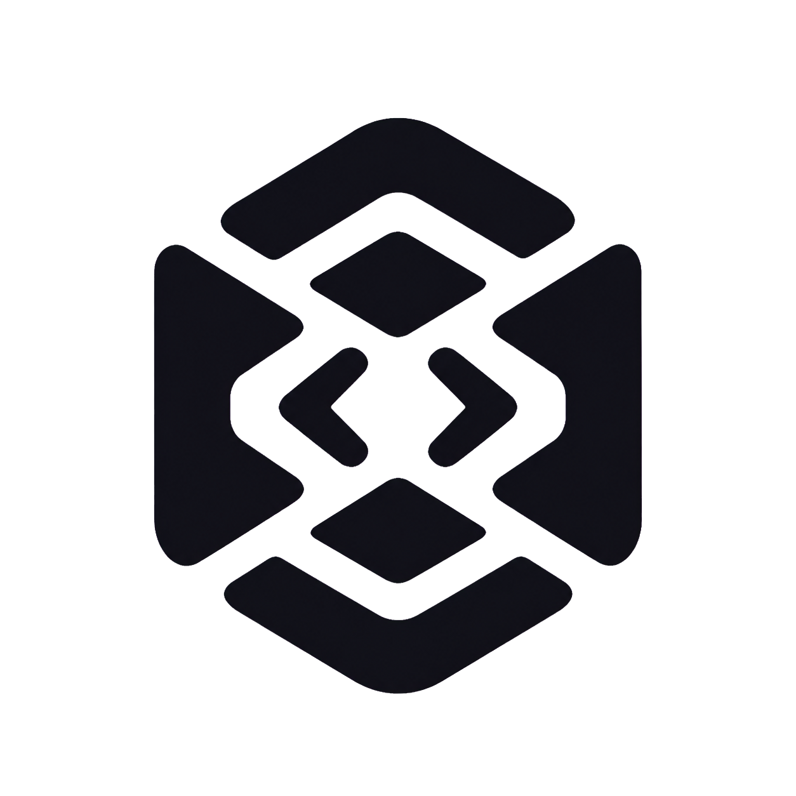
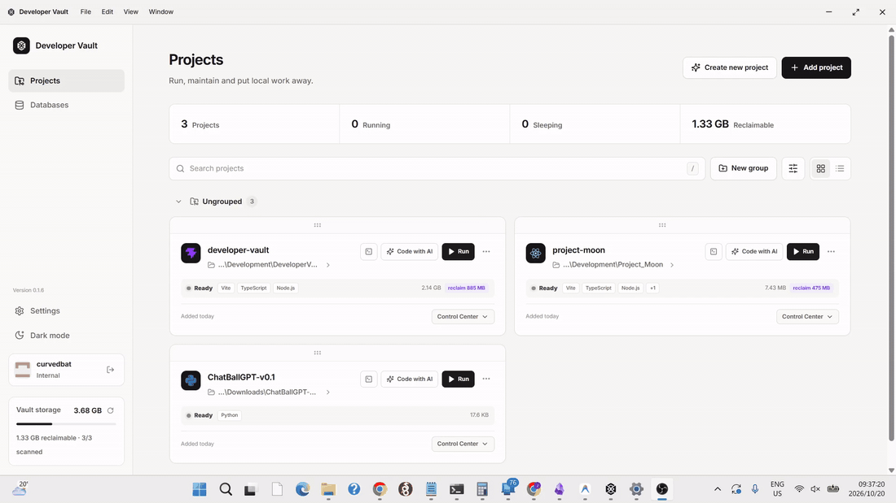

<div align="center">

  

  # Developer Vault
  ### **Vercel for your local machine — one place to run, manage, and build your local projects.**

  <p align="center">
    Put dormant projects to sleep to reclaim gigabytes of <code>node_modules</code>, run dev servers in a live mini-terminal right on the project card,<br/>
    push to GitHub, edit local databases like Google Sheets, and guide AI coding agents—without drowning in 15 open windows.
  </p>

  <p align="center">
    <a href="#-see-it-in-action"><b>Demo</b></a> •
    <a href="#-how-a-simple-what-if-snowballed-into-developer-vault"><b>The Story</b></a> •
    <a href="#-whats-inside-today-and-where-its-going"><b>What's Inside</b></a> •
    <a href="#-grab-the-public-beta-free-30-day-key"><b>Download Beta</b></a> •
    <a href="#-feedback-bugs--easter-egg-hunters"><b>Feedback</b></a>
  </p>

  
  
  

</div>

---

## 🎥 See It In Action

A clean, Vercel-style dashboard for all your local projects—complete with instant Dark & Light theme switching:

<div align="center">
  
</div>


---

## 💡 How A Simple *"What If?"* Snowballed Into Developer Vault

Developer Vault didn't start as a massive all-in-one app. It started because my SSD was full of dead `node_modules`.

I originally just wanted a **Vault**—a clean board where I could put every local project onto its own card, put old projects to **Sleep** (wiping reproducible `node_modules` and build caches to get gigabytes of storage back), and **Wake** them up whenever I needed them again.

Once I had all my projects sitting on cards in front of me, I kept asking myself **"What if...?"**

* *"What if I attach a **Run** button with a terminal straight onto the project card, instead of opening a terminal myself and typing `npm run dev` every single time?"*
  I started saving my launch arguments and streaming the live output inside a mini window right on the card. Once I saw my dev servers running live inside the cards—always in the exact same place, with an expand button if something ever went wrong—I knew I was onto something worth building properly (even if it's still far from perfect!).
* Later in development, I asked again: *"What if I put **GitHub Push & Pull** buttons right on the card too?"*
  I mainly code with AI, review their diffs, and guide project outcomes. The more features I added to the cards, the more I realized **I needed to open my heavy IDE or external terminals less and less**. Why boot up a whole IDE just to start a server, switch a branch, or push a commit?

Think about **Vercel**: it gives you one cohesive place to manage almost everything your project needs in **production**.
**What about local development?**

Instead of jumping between ten different windows for your terminals, Git accounts, AI agents, and databases (whether that's SQLite today, or Supabase and MongoDB tomorrow), I'm building **one local home for everything a project needs while you're building it**.

---

## ⚡ What's Inside Today (And Where It's Going)

### 1. 🗂️ Project Cards, Sleep/Wake & Live Mini-Terminals
Every project gets its own card on your board (organized into collapsible groups if you have lots of repos).
* **Sleep & Wake Storage Cleaner:** Put inactive projects to sleep in one click to reclaim gigabytes of `node_modules` and build caches while keeping your code safe. Click **Run** later and it wakes right back up.
* **Live Mini-Terminal on Every Card:** Save your run commands and arguments once, hit **Run**, and watch your terminal output stream live in a mini window right on the card. You always know exactly where your running process is—and if an error pops up, hit **Expand** (or pop it out into a floating window) to inspect it thoroughly.

### 2. 🌿 Everyday GitHub Right on the Card
No more opening a separate terminal or heavy IDE just to push your latest work.
* **Branch, Commit, Push & Pull:** Open the GitHub section on any project card to check changed files, write a commit, switch or create branches, and push/pull asynchronously.
* **Multi-Account GitHub Switching:** Switch between personal, college, or client GitHub accounts per repository so you never commit under the wrong identity, plus built-in safety checks before you accidentally stage oversized build files.

### 3. 🧠 Code with AI *(The Foundation)*
Apps like Antigravity and Codex are incredible, but I wanted two things: I didn't want to leave my project hub to talk to them, and I felt standalone agent apps pushed the code editor a little too far out of sight.
* **Multi-Agent Hub + Built-In Editor:** Talk to both **Google Antigravity** and **xAI Grok Build** inside Developer Vault, inspect modified files and diffs in the built-in Monaco code editor, and track your live model quotas and reset timers in one place.
* **The Long-Term Vision:** What's in the app today is an early foundation. Who knows what software development will look like in a few years—my long-term goal is to evolve this workspace into a true collaborative environment where humans and AI agents build projects side by side.

### 4. 🗄️ Built-In Database Studio *(Google Sheets Meets DB Manager)*
There are plenty of paid database clients out there that connect to dozens of providers, but again—I wanted **one space** inside my project hub to manage my databases without opening another heavy app.
* **Where It Is Now:** Today, Database Studio is an early skeleton starting with local **SQLite** databases (and a roadmap toward **Supabase, PostgreSQL, MongoDB**, and more).
* **The Goal:** I'm working toward making table browsing, filtering, inline cell editing, and quick math calculations (`Sum`, `Avg`, `Min`, `Max`, `Count`) feel as smooth and natural as **Google Sheets**, while still packing the power of a real schema & SQL database manager.

### 5. 📱 Native Android + On-Device Linux *(Alpha)*
Modern Android phones now ship with a native Linux environment right on the device—so I asked another *"What if?"* and made Developer Vault run on **Android** too.
* **Pocket Dev Environment (Experimental Alpha):** You can install the Android build and connect it to the native Linux environment running directly on your phone (or pair it with your PC) to browse files, clone repos, run dev servers, and use the AI workspace on the go. It is practically in **Alpha** right now, but the APK will be included in the releases for anyone curious enough to try it out!

### 6. 🥚 Built for Fun (Hidden Easter Eggs Inside)
One rule I refuse to break while building Developer Vault is **always having fun**. Software tools don't have to be dry and corporate—so I've hidden easter eggs inside the app, and I'll keep adding more with future updates. See if you can find them!

---

## 🎟️ Grab the Public Beta (Free 30-Day Key)

Developer Vault is currently in **Public Beta (`v0.1.7`)** for **Windows** (with an experimental **Android Alpha** build also available for those interested).

During the Public Beta, access is **100% free** using the 30-day GitHub beta invite code below:

1. **[Download the latest Windows installer (or Android APK) from the Releases Page](https://github.com/Developer-Vault-app/Developer-Vault/releases/latest)**
2. Install and launch **Developer Vault**, then sign in or create an account.
3. When prompted for your Beta Key, enter:

```text
DV-GITHUB-BETA
```

---

## 💬 Feedback, Bugs & Easter Egg Hunters

Developer Vault is a work in progress built from real daily workflow pain, and your feedback directly decides what gets polished or built next.

* **Found a bug or rough edge?** Open an issue in the [**Issues Tab**](https://github.com/Developer-Vault-app/Developer-Vault/issues).
* **Have a feature idea, feedback, or found one of the hidden easter eggs?** Drop a post in [**Discussions**](https://github.com/Developer-Vault-app/Developer-Vault/discussions)!

<div align="center">
  <sub>Built by <b>Jonathan Koekemoer</b></sub>
</div>
